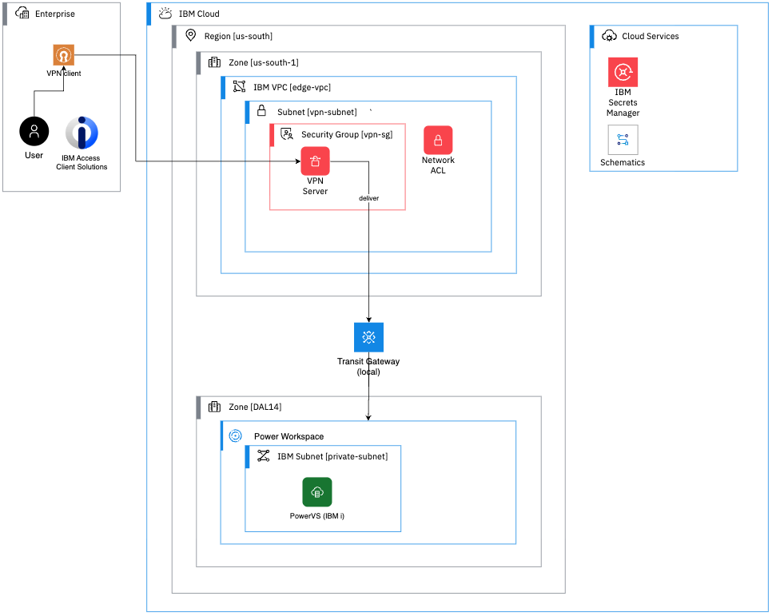

# powervs-lz

Terraform for an IBM Power Virtual Server (PowerVS) **landing zone** on IBM Cloud. It provisions an IBM i partition on a private network and gives a developer a secure way to reach it from their workstation (for example, from the IBM Bob IDE) over a client-to-site VPN.

## Purpose

A PowerVS partition has no public access. This repository builds the pieces needed to reach it safely:

- A **PowerVS workspace** with a private subnet and an **IBM i** partition.
- An **edge VPC** that hosts a **client-to-site VPN server**. This branch has no bastion VSI.
- A **Transit Gateway** that connects the edge VPC to the PowerVS workspace, so VPN clients can reach the IBM i partition.
- **Secrets Manager** as the store for the SSH public keys and the VPN server certificate, so no key material is kept in the code.
- **IAM access groups** for administrators, provisioners, viewers and VPN users.

The code is split into two Terraform configurations that you apply in order:

| Directory | Purpose |
|---|---|
| [`terraform/setup`](terraform/setup) | One-time account foundation: resource group, Secrets Manager, secret groups, IAM access groups and policies. |
| [`terraform`](terraform) | The landing zone: PowerVS, edge VPC, VPN and Transit Gateway. |

## Architecture



Traffic flows as follows:

1. The user connects with an OpenVPN client from the enterprise network (the IBM Bob IDE runs on this workstation).
2. The VPN server in the edge VPC (`us-south-1`) delivers the traffic onward to the PowerVS subnet.
3. The Transit Gateway carries the traffic from the edge VPC to the PowerVS workspace.
4. The IBM i partition sits in the private PowerVS subnet and is not exposed to the internet.

The diagram is a simplified view. In the code, the VPN server sits in its own subnet of the edge VPC (`vpn-server-subnet`) with its own network ACL and security group. The default PowerVS zone is `DAL12`, set by the `zone` variable.

## Outcome of running the Terraform

### `terraform/setup`

Creates the account foundation:

- Resource group (`resource_group` variable).
- Secrets Manager instance (`standard` plan, `us-south`, private endpoint only).
- Two Secrets Manager secret groups: one for PowerVS SSH public keys (default `powervs-ssh-keys`) and one for VPN certificates (`vpn-certificates`).
- IAM access groups:
  - `administrators` (account management, resource group and catalog policies)
  - `provisioners` (PowerVS, VPC, Transit Gateway, Schematics, Direct Link, Key Protect, Secrets Manager and Backup/Compass)
  - `viewers` (created with no policies yet)
  - `vpn_users` (VPN Client role on VPN servers)

The only output is the resource group name.

### `terraform`

Creates the landing zone, all named with your `prefix`:

| Area | Resources |
|---|---|
| **PowerVS** | Workspace (`<prefix>-power-workspace`), SSH key object, private VLAN subnet (`workload-subnet`), imported IBM i catalog image, IBM i instance (`<prefix>-power-vsi`, shared processors, Power11 by default) and a data volume (`data0-volume`) attached to it. |
| **Edge VPC** | VPC `edge-vpc` with manual address prefixes, a VPN server subnet, a routing table that accepts VPN server routes from the Transit Gateway, plus a network ACL and security group for the VPN subnet. |
| **Client-to-site VPN** | VPN server (UDP 443, certificate authentication, split tunneling) that uses a certificate from Secrets Manager. A route delivers traffic for the PowerVS subnet. An IAM authorization lets the VPN server read the certificate. |
| **Transit Gateway** | Local gateway `<prefix>-transit-gateway` with one connection to the edge VPC and one to the PowerVS workspace. |

Outputs:

- `message`: how to connect. Connect with OpenVPN, then follow the manual IBM i configuration steps.
- `catalog_image_ids`: a map of PowerVS catalog image names to image IDs, useful for choosing `powervs_image_id`.

## Install

These steps run both configurations in **IBM Cloud Schematics**. Run `terraform/setup` first, then `terraform`.

### Prerequisites

- An IBM Cloud account with **Virtual Routing and Forwarding (VRF)** and **Cloud Service Endpoints** enabled. Secrets Manager is accessed over its private endpoint.
- An IBM Cloud API key that can create the resources above.
- Access to this repository from Schematics. If it is a private repository, give Schematics a personal access token.

### Step 1: Run `terraform/setup`

1. In the IBM Cloud console, open **Schematics** and select **Create workspace**.
2. Enter the repository URL, the branch (`main`) and a Terraform version. Under **Folder**, enter `terraform/setup`. Select **Create**.
3. In the workspace **Settings**, set the variables:

   | Variable | Notes |
   |---|---|
   | `ibmcloud_api_key` | Mark as **sensitive**. |
   | `prefix` | Prefix added to resource names, for example `fis-horizon-poc`. |
   | `resource_group` | Name of the resource group to create. Use the same value in step 3. |
   | `secret_group_name` | Optional. Defaults to `powervs-ssh-keys`. |

4. Select **Generate plan**, review it, then select **Apply plan**.
5. Note the `resource_group` output.

### Step 2: Add secrets to Secrets Manager

Terraform reads these secrets but does not create them. Add them to the Secrets Manager instance that step 1 created:

1. In the `powervs-ssh-keys` secret group, add an **Other (arbitrary)** secret that holds an RSA SSH **public** key, used for the PowerVS partition.
2. In the `vpn-certificates` secret group, import the VPN server certificate as an **imported certificate**.
3. Record the Secrets Manager instance CRN, the `powervs-ssh-keys` secret group ID, and the two secret names.

### Step 3: Run `terraform`

1. Create a second Schematics workspace with the same repository and branch. Under **Folder**, enter `terraform`.
2. Set the variables:

   | Variable | Description |
   |---|---|
   | `ibmcloud_api_key` | Mark as **sensitive**. |
   | `prefix`, `resource_group` | Same values as in step 1. |
   | `region`, `zone`, `vpc_zone` | Default `us-south`, `DAL12`, `us-south-1`. Change `zone` to the PowerVS data center you want. |
   | `secrets_manager_instance_crn` | CRN of the Secrets Manager instance. |
   | `secrets_group_id` | ID of the `powervs-ssh-keys` secret group. |
   | `ssh_key_powervs_secret_name` | Name of the RSA public key secret (PowerVS). |
   | `vpn_certificate_name` | Name of the imported VPN certificate. |
   | `powervs_subnet_cidr` | CIDR of the PowerVS private subnet, for example `10.90.0.0/24`. |
   | `edge_vpc_address_prefix` | CIDR of the edge VPC, for example `10.80.0.0/24`. |
   | `edge_vpc_vpn_cidr` | VPN server subnet inside the VPC range, for example `10.80.0.0/25`. |
   | `powervs_image_id` | IBM i catalog image ID for your PowerVS zone. |
   | `powervs_instance_cores`, `powervs_instance_memory`, `powervs_instance_data0_volume`, `powervs_instance_data0_tier`, `powervs_system_type` | Optional sizing. See [`terraform/variables.tf`](terraform/variables.tf) for defaults. |

3. Select **Generate plan**, review it, then select **Apply plan**.
4. When the apply finishes, read the `message` output for the connection steps.

### Step 4: Connect

1. Create an OpenVPN client profile from the VPN server in the VPC console. Add your client certificate and private key.
2. Connect the VPN.
3. Reach the IBM i partition on the PowerVS subnet.

### Step 5: Configure IBM i after deploy

Terraform creates the partition but not its IBM i settings, so a new partition needs these one-time steps. They run on the partition itself, so repeat them after rebuilding it. The same steps are in the `message` output.

1. Open the IBM i console: **Resources list** > your PowerVS workspace > **Virtual server instances** > `<prefix>-power-vsi` > **Actions** > **Open console**. Sign on as `QSECOFR`. If the system prompts for a new password, enter one and continue.
2. Reset the `QSECOFR` password:

   ```
   CHGUSRPRF USRPRF(QSECOFR) PASSWORD(<new_password>) PWDEXP(*NO) STATUS(*ENABLED)
   ```

3. Accept the software license agreements with `WRKSFWAGR`. Accept every agreement that is not already accepted.
4. Set the system values that affect 5250 sign-on:

   | System value | Default | Set to | Why |
   |---|---|---|---|
   | `QAUTOVRT` | `0` | `100` (required) | At `0`, IBM i cannot create virtual devices. A Telnet session then fails with ACS response code `8917 Not authorized to object` before the sign-on screen. |
   | `QLMTSECOFR` | `1` | `0` (optional) | At `1`, `QSECOFR` and any profile with `*ALLOBJ` or `*SERVICE` can sign on only at devices explicitly authorized to it. `0` allows any device. This loosens security, which is acceptable for a PoC behind the VPN. |

   ```
   CHGSYSVAL SYSVAL(QAUTOVRT) VALUE(100)
   ```

   `QLMTSECOFR` is a security system value and may be locked. If `CHGSYSVAL` fails with `CPF18C0` ("cannot be changed"), unlock it, change it, then lock it again:

   ```
   CHGSSTSECA SECSYSVAL(*YES)
   CHGSYSVAL SYSVAL(QLMTSECOFR) VALUE('0')
   CHGSSTSECA SECSYSVAL(*NO)
   ```

5. Start the Telnet server, and have it start after each IPL:

   ```
   STRTCPSVR SERVER(*TELNET)
   CHGTELNA AUTOSTART(*YES)
   ```

6. Connect with ACS 5250 while the VPN is up. Use the partition IP address (the `message` output shows it) and port `23`. Leave the **Workstation ID** blank so IBM i creates a `QPADEV*` virtual device for the session.

Troubleshooting:

- **Connection refused on port 23:** the Telnet server is not started (step 5).
- **`8917 Not authorized to object`:** check `QAUTOVRT` first (step 4).
- **Ping to the PowerVS gateway works but not to the partition:** check `WRKTCPSTS OPTION(*IFC)`. If only `127.0.0.1` is listed, no TCP/IP interface is configured on the partition. The PowerVS subnet has DHCP disabled, so IBM i must define the interface itself (`CRTLINETH`, `ADDTCPIFC`, `STRTCPIFC`) and a default route to the subnet gateway (`ADDTCPRTE`). Match the Ethernet line to the partition's MAC address, which `ibmcloud pi instance get <id>` shows.
- **Telnet is not encrypted.** Use SSH (port 22) where possible.

### Tear down

Destroy in the reverse order: run **Destroy resources** on the `terraform` workspace first, then on the `terraform/setup` workspace.

## Notes

- `*.tfvars` and `*.tfstate*` are listed in [`.gitignore`](.gitignore), so credentials and state are not committed. Provide variable values in Schematics.
- The provider is pinned to `IBM-Cloud/ibm` version `2.8.0` in `versions.tf`.
